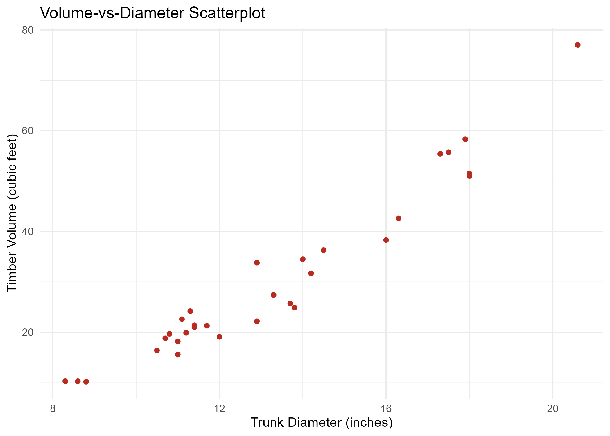
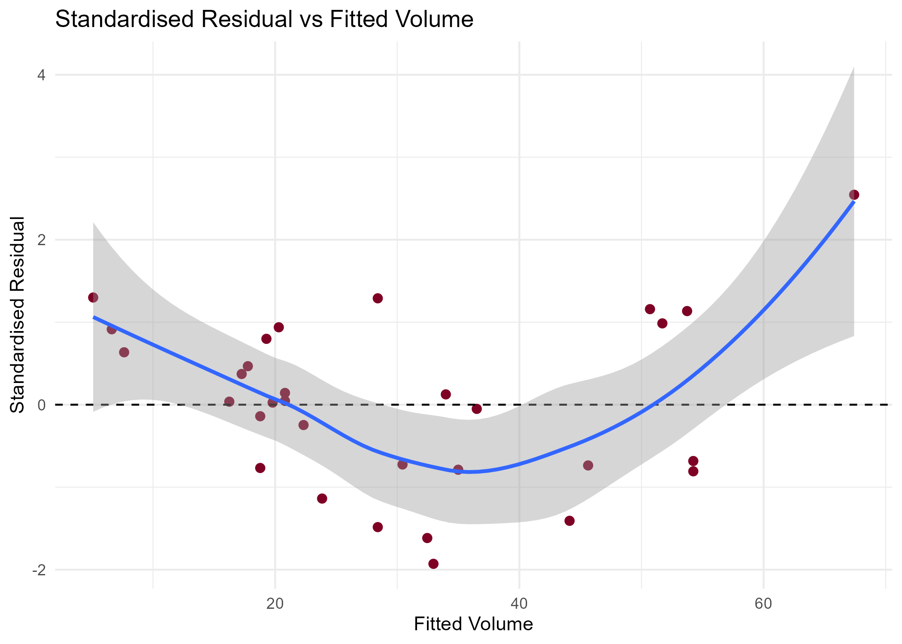
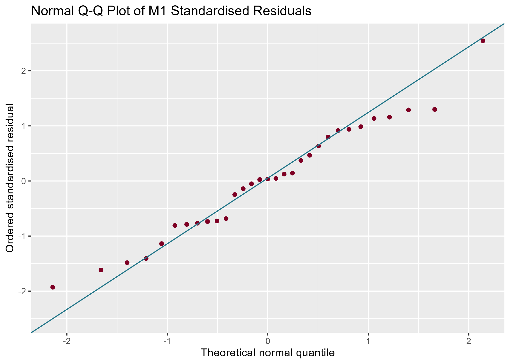
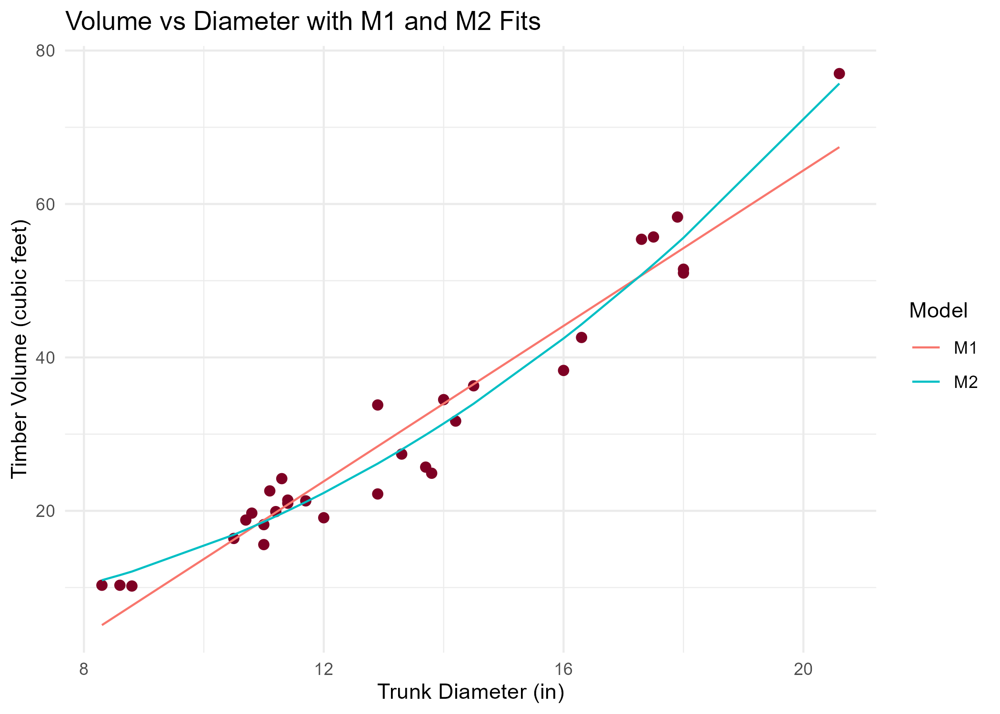
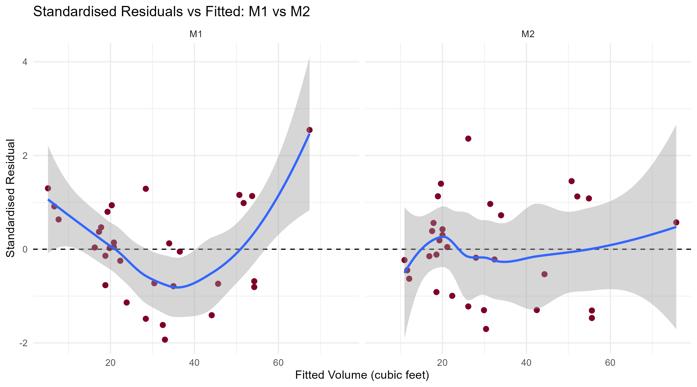
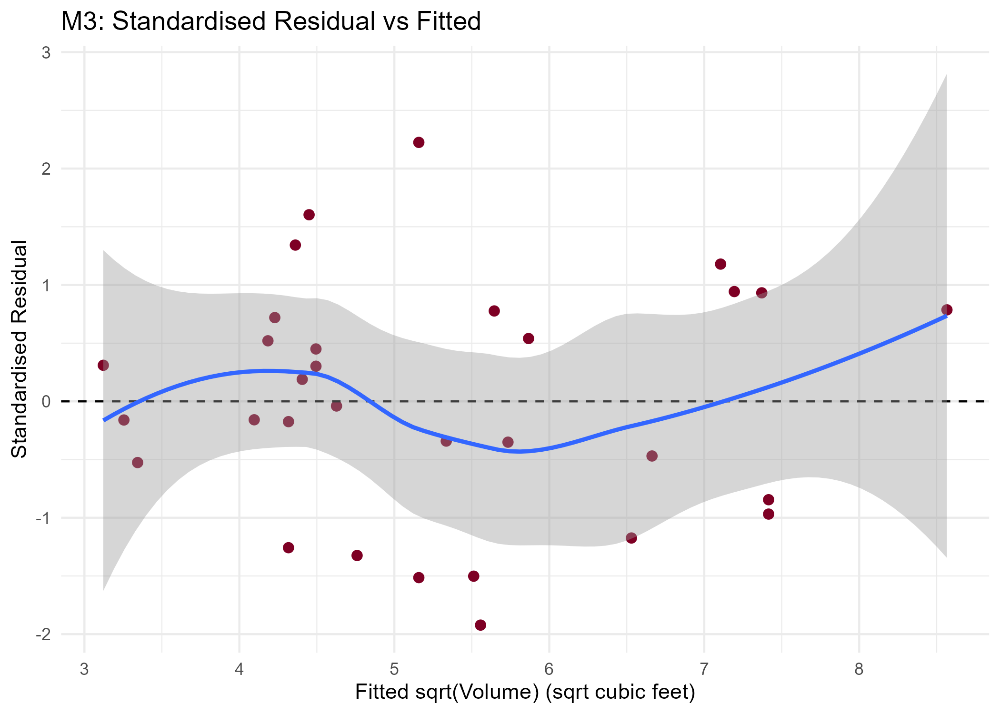
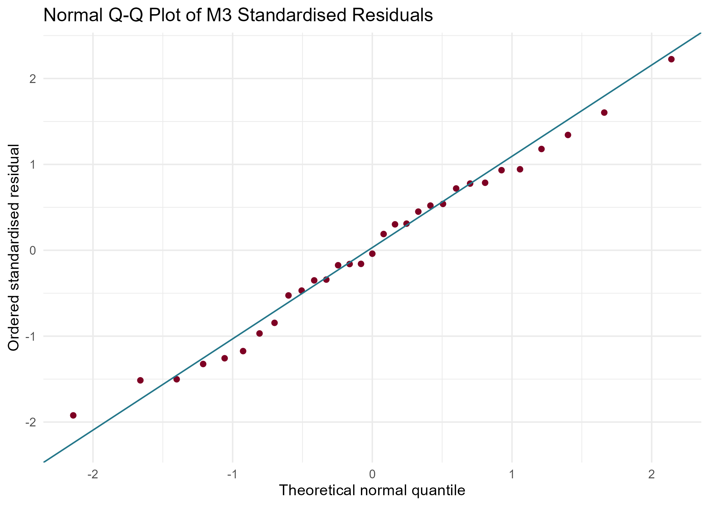
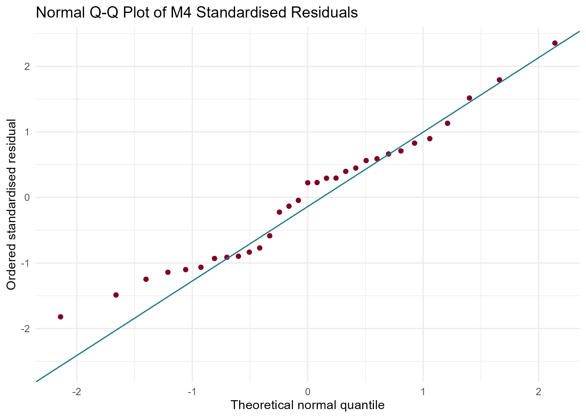
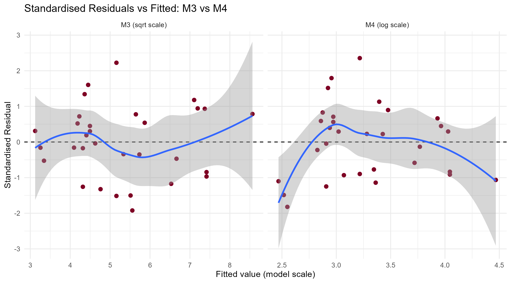

# Tutorial 2 Report
### Name: Sametha Sivalingam
### Matrix Number: SA00280

## Aim
To investigate the relationship between trunk diameter and timber volume of 31 black cherry trees.

## Dataset Specification
The dataset used in this analysis consists of measurements of 31 black cherry trees from the R datasets package (`trees::datasets`).

| Variable | Definition |
|:---------|:-----------|
| `tree_id` | Tree Identifier |
| `girth_in` | Trunk diameter (inches / in) |
| `height_ft` | Tree height (feet / ft) |
| `volume_ft3` | Timber volume (cubic feet / $ft^3$) |
*Table 1: Dataset Specification*

In this report, `volume_ft3` is referred to as either *volume* or *timber volume*, while `girth_in` is either referred to as *diameter* or *trunk diameter*.

## Q1(a): Inspect and Describe
```r
## Import data
trees_raw <- read.csv("data/STS4407_Tutorial2_Trees.csv")

## Number of trees
nrow(trees_raw) # 31 rows
length(unique(trees_raw$tree_id)) # 31 unique tree id's

## Missing values
colSums(is.na(trees_raw)) # 0 in every column

## Diameter range
range(trees_raw$girth_in, na.rm = TRUE) # 8.3 - 20.6

## Volume-vs-diameter scatterplot
vol_diameter_plot <- ggplot(trees_raw,
    aes(x = girth_in, y = volume_ft3)) +
    geom_point(colour = "#b82b21") +
    labs(title = "Volume-vs-Diameter Scatterplot",
        x = "Trunk Diameter (inches)",
        y = "Timber Volume (cubic feet)") + theme_minimal()
```
The dataset (`data/STS4407_Tutorial2_Trees.csv`) contains measurements of black cherry trees from the `trees` dataset in R's `datasets` package. It has 31 rows and 31 unique tree IDs, confirming that there are 31 trees. No missing values were found in any column. Trunk diameter (`girth_in`) ranges from 8.3 to 20.6 inches. The response is `volume_ft3`, the timber volume in cubic feet ($ft^3$), and the predictor is `girth_in`, the trunk diameter in inches.

{width=70%}

The scatterplot shows a strong positive relationship between trunk diameter and timber volume. Trees with larger trunk diameters generally have greater timber volumes. The pattern has a slight upward curve, suggesting that volume increases more rapidly at larger diameters rather than at a perfectly constant rate. There are no obvious outliers. The point near 21 inches and 77 cubic feet is far from most of the data but follows the overall upward pattern.

## Q1(b): Fit and Interpret M1
```r
## Fit M1
M1 <- lm(volume_ft3 ~ girth_inc, data = trees_raw)

## Summary
summary(M1)
```
From the summary of the fitted M1 linear regression model:\
Fitted Equation: Volume = -36.9435 + 5.0659(Diameter)\
Interpretation: For each additional 1 inch in trunk diameter, the predicted timber volume increases by approximately 5.07 cubic feet.

R-squared = 0.9353\
Residual Standard Error = 4.252

The intercept should not be given a physical interpretation because it predicts a timber volume of approximately -36.94 when the trunk diameter is zero. This is not physically meaningful because a negative timber volume is impossible.

## Q1(c): Prediction and uncertainty
```r
## Tree with diameter 15 inches
new_tree_data <- data.frame(girth_in = 15.00)

## Obtain M1 fitted value for new tree and 95% CI for mean volume
predict(M1, newdata = new_tree_data,
    interval = "confidence", level = 0.95) 
# fitted value = 39.04439
# 95% C.I. = (37.24848, 40.84019) cubic feet

## Fitted value and 95% prediction interval for one tree
predict(M1, newdata = new_tree_data,
    interval = "prediction", level = 0.95)
# fitted value = 39.04439
# 95% Prediction Interval = (30.16461, 47.92416) cubic feet
```
Fitted Value = 39.04439\
95% Confidence interval for mean volume = (37.24848, 40.84019)\
95% Prediction Interval = (30.16461, 47.92416)

The 95% confidence interval estimates the mean volume of all trees with a diameter of 15 inches. It reflects uncertainty in estimating the mean response. However, the 95% prediction interval predicts the volume of one individual tree with a diameter of 15 inches. The prediction interval is wider because it includes uncertainty in the estimated mean and the additional variation between individual trees. This is interpolation since 15 inches lies within the observed trunk diameter range of 8.3 - 20.6 inches.

## Q1(d): Residual Calculation
```r
## Add columns for fitted values and residuals
tree_fit_df <- trees_raw %>%
    mutate(fitted_volume = fitted(M1),
        residual = residuals(M1))

## Filter for tree with id "B05"
tree_b05 <- tree_fit_df %>%
    filter(tree_id == "B05")

## Calculate observed minus fitted
print(tree_b05["volume_ft3"] - tree_b05["fitted_volume"]) 
```

Observed Volume = 18.8 cubic feet\
Fitted Volume = 17.26 cubic feet\
Residual = 1.54 cubic feet

The residual is positive which means Tree B05's observed volume is approximately 1.54 cubic feet greater than its fitted volume. This suggests that the M1 model underestimates this tree's timber volume by approximately 1.54 cubic feet. The residual has the same unit as the timber volume as both the observed values and fitted values reflect the same variable. The residual is observable because it is calculated using the observed volume and the fitted regression line. It estimates the true error because the true population mean relationship is unknown.

## Q2(a): Residual Pattern
```r
## Add column for standardised residuals of M1 model
tree_fit_df <- tree_fit_df %>%
    mutate(std_residual = rstandard(M1))

## Standardised Residual-vs-fitted plot
stdr_fitted_plot <- ggplot(tree_fit_df,
    aes(x = fitted_volume, y = std_residual)) +
    geom_point(colour = "#7E0024", size = 2) +
    geom_hline(yintercept = 0, linetype = "dashed") +
    geom_smooth(method = "loess", formula = y ~ x, se = TRUE) + 
    labs(title = "Standardised Residual vs Fitted Volume",
        x = "Fitted Volume", y = "Standardised Residual") + theme_minimal()
```

{width=70%}


The residual plot displays a U-shaped pattern, with mostly positive residuals at low and high fitted volumes.There are mostly negative residuals in the middle. This suggests that the fitted mean does not fully capture the curvature in the relationship. The model tends to underestimate mean timber volume at the extremes and overestimate it in the middle. There is no clear funnel-shaped pattern, so changing residual spread is not the most obvious concern, although the small number of observations at higher fitted volumes makes it difficult to assess. The wider shaded band at the extremes reflects uncertainty in the estimated smooth trend, not necessarily greater error variance. Overall, the plot raises concern about the specification of the fitted mean, but it neither proves non-linearity or establishes that the error variance is constant.

## Q2(b): Normality and Independence
```r
## Normal Q-Q Plot of M1 standardised residuals
m1_qq_plot <- ggplot(tree_fit_df,
    aes(sample = std_residual)) +
    stat_qq(colour = "#7E0024") +
    stat_qq_line(colour = "#24778A") +
    labs(title = "Normal Q-Q Plot of M1 Standardised Residuals",
        x = "Theoretical normal quantile",
        y = "Ordered standardised residual")
```

{width=70%}


The points in the middle follow the reference line closely which suggests consistency with normality. However, the tails on both ends depart slightly. At the lower end, the lowest points sit above the line, so the lower tail looks lighter than normal. At the upper end, the points from approximately 1 to 1.7 fall below the line, then the single largest point (approximately 2.5) lands on or just above it. This gives a mild right-skew pattern. 

The errors are assumed normal. A Q-Q plot cant show independence because it ignores the order and structure of the data. The plot only shows the marginal distribution of the residuals.

## Q2(c): Quadratic Candidate, M2
```r
## Fit M2
M2 <- lm(volume_ft3 ~ girth_in + I(girth_in^2), data = trees_raw)
summary(M2)

## Overlay M1 and M2 fitted curves on original scatterplot.
tree_compare_fit <- trees_raw %>% 
    mutate(fit_M1 = fitted(M1),
        fit_M2 = fitted(M2))

m1_vs_m2_fits <- ggplot(tree_compare_fit, aes(x = girth_in, y = volume_ft3)) +
    geom_point(colour = "#7E0024", size = 2) +
    geom_line(aes(y = fit_M1, colour = "M1")) +
    geom_line(aes(y = fit_M2, colour = "M2")) +
    labs(title = "Volume vs Diameter with M1 and M2 Fits",
        x = "Trunk Diameter (in)", y = "Timber Volume (cubic feet)", colour = "Model") +
    theme_minimal()
```
Fitted equation:\
$\text{Volume} = 10.78627 - 2.09214(Diameter) + 0.25454(Diameter^2)$

{width=70%}

Figure 4 overlays the two fitted models on the scatterplot of timber volume against trunk diameter (the original scatterplot). The M1 curve is a straight line and it fits the middle of the data reasonably well but misses systematically at the extremes. It underestimates volume for the smallest trees (below about 9 inches) and for the largest tree (about 20.6 inches), while it tends to sit slightly above the observations in the mid-range of roughly 12-16 inches. The M2 curve bends upward and follows the observations more closely across the whole range of diameters, indicating that volume increases faster than linearly with diameter. The two curves cross approximately 17 inches, where both models give similar prediction.

M2 is specified as `lm(volume ~ girth_in + I(girth_in^2), data = trees_raw)`. The function `I()` is needed because the `^` operator has a special meaning inside an R formula, where it is used to generate interaction terms. Without `I()`, the term `girth_in^2` would be interpreted as formula syntax and would reduce to `girth_in`. Wrapping the expression in `I()` instructs R to treat it as is and evaluate it as ordinary arithmetic, so that a new predictor containing the squared trunk diameter of each tree is created.

Although the fitted curve for M2 is nonlinear in diameter, the model itself is linear in its coefficients. It can be writte as $\text{Timber Volume} = \beta_0 + \beta_1(diameter) + \beta_2(diameter^2) + \epsilon$. The term linear in linear regression refers to linearity in the parameters, not the predictors. 

## Q2(d): Comparing M1 and M2
```r
## Adjusted R-sqaured of M1 and M2
summary(M1)$adj.r.squared # 0.9330895
summary(M2)$adj.r.squared # 0.9588428

## Residual Standard Errors of M1 and M2
summary(M1)$sigma # 4.251988
summary(M2)$sigma # 3.334785

## Standardised Residual Plots for M1 and M2 (side-by-side comparison)
resid_compare <- bind_rows(
    tree_fit_df %>% transmute(model = "M1", fitted = fitted_volume, std_resid = std_residual),
    tree_fit_df %>% transmute(model = "M2", fitted = fitted_M2, std_resid = std_resid_M2))

resid_compare_plot <- ggplot(resid_compare, aes(x = fitted, y = std_resid)) +
    geom_point(colour = "#7E0024", size = 2) +
    geom_hline(yintercept = 0, linetype = "dashed") +
    geom_smooth(method = "loess", formula = y ~ x, se = TRUE) +
    facet_wrap(~ model) +
    labs(title = "Standardised Residuals vs Fitted: M1 vs M2",
        x = "Fitted Volume (cubic feet)", y = "Standardised Residual") +
    theme_minimal()
```

Model M1:\
- Adjusted $R^2$ = 0.9331\
- Residual Standard Error = 4.2520

Model M2:\
- Adjusted $R^2$ = 0.9588\
- Residual Standard Error = 3.3348


{width=90%}

*M2* provides the more adequate mean shape for these data. Its adjusted R-sqaured is higher (0.9588 vs 0.9331 for M1), and its residual standard error is smaller (3.3345 vs 4.2520 cubic feet for M1), so it explains more variation with smaller typical prediction errors even after penalising for the extra parameter. The standardised residual plots agree that M1 shows a clear U-shaped pattern, indicating unmodelled curvature, whereas M2's residuals scatter evenly around zero with no strong trend. One limit of this comparison is that all measures are in-sample and based on only 31 observations, so they do not show how well either model would predict new data.

## Q3(a): Square-Root Response, M3
```r
## Fit M3
M3 <- lm(sqrt(volume_ft3) ~ girth_in, data = trees_raw)

## Summary of M3
summary(M3)

## Standardised residual-vs-fitted plot for M3
m3_resid_plot <- ggplot(tree_fit_df,
    aes(x = fitted_M3, y = std_resid_M3)) +
    geom_point(colour = "#7E0024", size = 2) +
    geom_hline(yintercept = 0, linetype = "dashed") +
    geom_smooth(method = "loess", formula = y ~ x, se = TRUE) +
    labs(title = "M3: Standardised Residual vs Fitted",
        x = "Fitted sqrt(Volume) (sqrt cubic feet)", y = "Standardised Residual") +
    theme_minimal()

## Normal Q-Q plot for M3
m3_qq_plot <- ggplot(tree_fit_df, aes(sample = std_resid_M3)) +
    stat_qq(colour = "#7E0024") +
    stat_qq_line(colour = "#24778A") +
    labs(title = "Normal Q-Q Plot of M3 Standardised Residuals",
        x = "Theoretical normal quantile",
        y = "Ordered standardised residual") +
    theme_minimal()
```

Fitted Equation:\
$\sqrt{Volume}$ = -0.5518 + 0.4426(Diameter)
For each additional 1 inch of trunk diameter, the expected square-root volume increases by 0.4426 $\sqrt{\text{ft}^3}$. On the volume scale, the change is not constant. Squaring the fitted value means the increase in volume per inch grows with diameter.

{width=70%}

{width=70%}

The standardised residuals against fitted values for M3 scatter around zero with no strong systematic pattern. The normal Q-Q plot shows points close to the reference line, with only mild departures in the lower tail, which is acceptable for 31 observations. Compared with M1, whose residuals showed a clear U-shaped pattern indicating unmodelled curvature, M3 appears to have a more adequate mean pattern, since the square-root transformation has largely removed that curvature without adding a quadratic term. Since M3 and M1 use different response scales ($\sqrt{cubic feet}$ vs cubic feet), their residual standard errors and R-squared values are not directly comparable, so this comparison relies on the diagnostic plots.

## Q3(b): Log Response, M4
```r
## Check that the log transformation is defined (volume must be > 0)
any(trees_raw$volume_ft3 <= 0)   # FALSE 
min(trees_raw$volume_ft3) # 10.2

## Fit M4
M4 <- lm(log(volume_ft3) ~ girth_in, data = trees_raw)

## Summary of M4
summary(M4)

## Add fitted values and standardised residuals for M4 to df
tree_fit_df <- tree_fit_df %>%
    mutate(fitted_M4 = fitted(M4),
        std_resid_M4 = rstandard(M4))

## Standardised residual-vs-fitted plot for M4
m4_resid_plot <- ggplot(tree_fit_df,
    aes(x = fitted_M4, y = std_resid_M4)) +
    geom_point(colour = "#7E0024", size = 2) +
    geom_hline(yintercept = 0, linetype = "dashed") +
    geom_smooth(method = "loess", formula = y ~ x, se = TRUE) +
    labs(title = "M4: Standardised Residual vs Fitted",
        x = "Fitted log(Volume) (log cubic feet)", y = "Standardised Residual") +
    theme_minimal()

## Normal Q-Q plot for M4
m4_qq_plot <- ggplot(tree_fit_df, aes(sample = std_resid_M4)) +
    stat_qq(colour = "#7E0024") +
    stat_qq_line(colour = "#24778A") +
    labs(title = "Normal Q-Q Plot of M4 Standardised Residuals",
        x = "Theoretical normal quantile",
        y = "Ordered standardised residual") +
    theme_minimal()
```
Fitted Equation:\
$\ln{(Volume)} = 1.1190 + 0.1626(Diameter)$

The log transformation is defined because `log()` needs strictly positive values and `min(trees_raw$volume_ft3)` is 10.2 with `any(volume_ft3 <= 0)` returning FALSE. M4 is therefore fitted on the natural-log scale, giving the fitted equation $\ln{(Volume)} = 1.1190 + 0.1626(Diameter)$. The response is in log cubic feet, so exponentiating a fitted value from the M4 model gives volume in cubic feet, and each extra inch of diameter (`girth_in`) multiplies volume by $exp(0.1626).

{width=70%}

The normal Q-Q plot of M4 Standardised Residuals show points reasonably close to the reference point near the middle, with mild departures at the lower tail and a slight excess above the line through the middle, which is acceptable for 31 observations. 

{width=90%}

In the M4 residual plot, the LOESS smoother starts near -1.7 at the smallest fitted values, rises to about 0.5 near a fitted value of 3.0, and then declines to about -1 at the largest fitted values. The confidence band is wide at both ends, so the pattern there should be interpreted cautiously, but the overall shape is clearly curved.

By comparison, M3's smoother stays within roughly -0.4 to 0.7, and its confidence band contains zero throughout. M4 therefore appears to leave more residual structure than M3, which may indicate some remaining misfit in the mean pattern, although this is uncertain given the small sample size. Overall, M3 appears to give the more adequate mean pattern, while M4 is acceptable with respect to normality but shows some remaining mean-pattern misfit.

## Q3(c): Return to the volume scale
```r
## Predictions at diameter = 15 inches (new_tree_data from Q1(c))
pred_M1 <- predict(M1, newdata = new_tree_data)   # cubic feet
pred_M3 <- predict(M3, newdata = new_tree_data)   # sqrt(cubic feet)
pred_M4 <- predict(M4, newdata = new_tree_data)   # log(cubic feet)

## Direct inverses back to the volume scale
pred_M3_vol <- pred_M3^2      # square the M3 prediction
pred_M4_vol <- exp(pred_M4)   # exponentiate the M4 prediction
```

| Model | Model Scale Prediction | Model Scale | Volume Scale Prediction |
|:------|:-----------------------|:------------|:------------------------|
| M1 | 39.04 | cubic feet | 39.04 |
| M3 | 6.09 | $\sqrt{cubic feet}$ | 37.06 |
| M4 | 3.56 | $\ln{(cubic feet)}$ | 35.07 |
*Table 2: M1 vs M3 vs M4: Predictions at 15 inches*

At a diameter of 15 inches, M1 predicts a mean volume of 39.04 cubic feet. M3 predicts 6.09 on the square-root scale, which squares to 37.06 cubic feet, and M4 predicts 3.56 on the log scale, which exponentiates to 35.07 cubic feet. Both back-transformed values are lower than M1's predicted value by about 5% for M3 and 10% for M4.

These direct inverses are not automatically conditional mean volumes because the mean of a transformed variable is not the transform of the mean. Squaring the M3 fitted values omits the variance term on the square-root scale, and exponentiating the M4 fitted value omits the $exp(\sigma^2/2)$ factor when the log-scale errors are normal, so both tend to underestimate the mean volume. Back-transforming a prediction from the square-root or log scale gives an estimate of the median volume rather than the mean, because the mean of a transformed variable is not the transform of its mean, so the lower values for M3 and M4 are expected and do not by themselves indicate that M1 is more accurate.

\newpage
## Recommendation

| Model | Response | Unit | Adj. $R^2$ | RSE |
|:------|:---------|------|:-----------|:----|
| M1 | Volume | $ft^3$ | 0.9331 | 4.25 |
| M2 | Volume | $ft^3$ | 0.9588 | 3.33 |
| M3 | $\sqrt{Volume}$ | $\sqrt{ft^3}$ | 0.9555 | 0.2997 |
| M4 | $\log{(Volume)}$ | $\ln{(ft^3)}$ | 0.9376 | 0.1314 |
*Table 3: Model Summaries*

I recommend M2 as the preferred model, with M3 as a close alternative. M1 has the weakest adjusted $R^2$ (0.9331) and a clear U-shaped residual pattern, indicating unmodelled curvature. M2 has the highest adjusted $R^2$ (0.9588) and the lowest RSE (3.33 $ft^3$), and its residuals show no strong trend. M3’s residuals also show no strong systematic pattern, but M4’s smoother retains some curvature, though this is uncertain at the extremes. M1 and M2 are on the volume scale, so their predictions are directly in cubic feet. M3 and M4 predict $\sqrt{ft^3}$ and $\ln{(ft^3)}$, so back-transformed values estimate median rather than mean volume. Adjusted $R^2$ and RSE from different response scales cannot rank predictive quality, because they measure variation in different quantities with different units which means that RSE values of 3.33, 0.2997 and 0.1314 are not comparable. Better prediction would require out-of-sample evidence, such as cross-validated errors computed on the volume scale. 

Limitations: Only 31 observations, and the diagnostics are visual and in-sample.