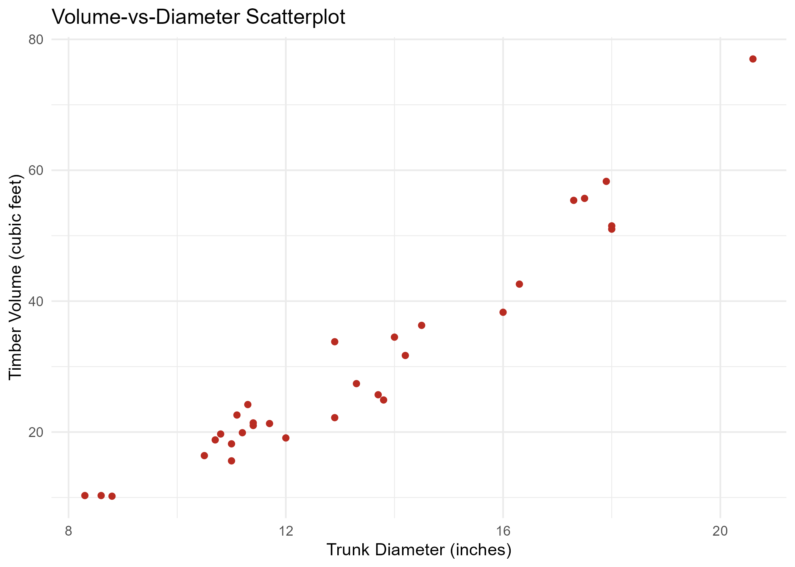
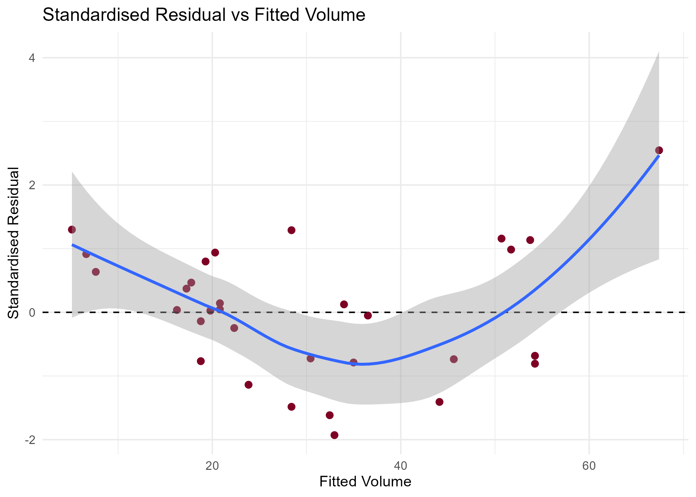
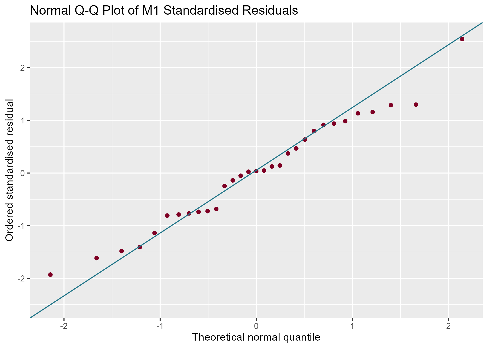

# Tutorial 2 Report
### Name: Sametha Sivalingam
### Matrix Number: SA00280

## Aim
To investigate the relationship between trunk diameter and timber volume of 31 black cherry trees.

## Dataset Specification
Measurements of 31 black cherry trees from the R datasets package (`trees::datasets`).

| Variable | Definition |
|:---------|:-----------|
| `tree_id` | Tree Identifier |
| `girth_in` | Trunch diameter (inches) |
| `height_ft` | Tree height (feet) |
| `volume_ft3` | Timber volume (cubic feet) |

In this analysis, only `volume_ft3` and `girth_in` is used for the subsequent models.

## Q1(a): Inspect and Describe
```r
## Import data
trees_raw <- read.csv("data/STS4407_Tutorial2_Trees.csv")

## Number of trees
nrow(trees_raw) # 31 rows
length(unique(trees_raw$tree_id)) # 31 unique tree id's

## Missing values
colSums(is.na(trees_raw)) # 0 in every column

## Diameter range
range(trees_raw$girth_in, na.rm = TRUE) # 8.3 - 20.6

## Volume-vs-diameter scatterplot
vol_diameter_plot <- ggplot(trees_raw,
    aes(x = girth_in, y = volume_ft3)) +
    geom_point(colour = "#b82b21") +
    labs(title = "Volume-vs-Diameter Scatterplot",
        x = "Trunk Diameter (inches)",
        y = "Timber Volume (cubic feet)") + theme_minimal()
```
The dataset (`data/STS4407_Tutorial2_Trees.csv`) contains measurements of black cherry trees from the `trees` dataset in R's `datasets` package. It has 31 rows and 31 unique tree IDs, confirming that there are 31 trees. No missing values were found in any column. Trunk diameter (`girth_in`) ranges from 8.3 to 20.6 inches. The response is `volume_ft3`, the timber volume in cubic feet, and the predictor is `girth_in`, the trunk diameter in inches.

{width=70%}

The scatterplot shows a strong positive relationship between trunk diameter and timber volume. Trees with larger trunk diameters generally have greater timber volumes. The pattern has a slight upward curve, suggesting that volume increases more rapidly at larger diameters rather than at a perfectly constant rate. There are no obvious outliers. The point near 21 inches and 77 cubic feet is far from most of the data but follows the overall upward pattern.

## Q1(b): Fit and Interpret M1
```r
## Fit M1
M1 <- lm(volume_ft3 ~ girth_inc, data = trees_raw)

## Summary
summary(M1)
```
From the summary of the fitted M1 linear regression model:\
Fitted Equation: Timber Volume = -36.9435 + 5.0659(Trunk Diameter)\
Interpretation: For each addition 1 inch in trunk diameter, the predicted timber volume increases by approximately 5.07 cubic feet.

R-squared = 0.9353\
Residual Standard Error = 4.252

The intercept should not be given a physical interpretation because it predicts a timber volume of approximately -36.94 when the trunk diameter is zero. This is not physically meaningful because a negative timber volume is impossible.

## Q1(c): Prediction and uncertainty
```r
## Tree with diameter 15 inches
new_tree_data <- data.frame(girth_in = 15.00)

## Obtain M1 fitted value for new tree and 95% CI for mean volume
predict(M1, newdata = new_tree_data,
    interval = "confidence", level = 0.95) 
# fitted value = 39.04439
# 95% C.I. = (37.24848, 40.84019) cubic feet

## Fitted value and 95% prediction interval for one tree
predict(M1, newdata = new_tree_data,
    interval = "prediction", level = 0.95)
# fitted value = 39.04439
# 95% Prediction Interval = (30.16461, 47.92416) cubic feet
```
Fitted Value = 39.04439\
95% Confidence interval for mean volume = (37.24848, 40.84019)\
95% Prediction Interval = (30.16461, 47.92416)

The 95% confidence interval estimates the mean volume of all trees with a diameter of 15 inches. It reflects uncertainty in estimating the mean response. However, the 95% prediction interval predicts the volume of one individual tree with a diameter of 15 inches. The prediction interval is wider because it includes uncertainty in the estimated mean and the additional variation between individual trees. This is interpolation since 15 inches lies within the observed trunk diameter range of 8.3 - 20.6 inches.

## Q1(d): Residual Calculation
```r
## Add columns for fitted values and residuals
tree_fit_df <- trees_raw %>%
    mutate(fitted_volume = fitted(M1),
        residual = residuals(M1))

## Filter for tree with id "B05"
tree_b05 <- tree_fit_df %>%
    filter(tree_id == "B05")

## Calculate observed minus fitted
print(tree_b05["volume_ft3"] - tree_b05["fitted_volume"]) 
```

Observed Volume = 18.8 cubic feet\
Fitted Volume = 17.26 cubic feet\
Residual = 1.54 cubic feet

The residual is positive which means Tree B05's observed volume is approximately 1.54 cubic feet greater than its fitted volume. This suggests that the M1 model underestimates this tree's timber volume by approximately 1.54 cubic feet. The residual has the same unit as the timber volume as both the observed values and fitted values reflect the same variable. The residual is observable because it is calculated using the observed volume and the fitted regression line. It estimates the true error because the true population mean relationship is unknown.

## Q2(a): Residual Pattern
```r
## Add column for standardised residuals of M1 model
tree_fit_df <- tree_fit_df %>%
    mutate(std_residual = rstandard(M1))

## Standardised Residual-vs-fitted plot
stdr_fitted_plot <- ggplot(tree_fit_df,
    aes(x = fitted_volume, y = std_residual)) +
    geom_point(colour = "#7E0024", size = 2) +
    geom_hline(yintercept = 0, linetype = "dashed") +
    geom_smooth(method = "loess", formula = y ~ x, se = TRUE) + 
    labs(title = "Standardised Residual vs Fitted Volume",
        x = "Fitted Volume", y = "Standardised Residual") + theme_minimal()
```

{width=70%}


The residual plot displays a U-shaped pattern, with mostly positive residuals at low and high fitted volumes.There are mostly negative residuals in the middle. This suggests that the fitted mean does not fully capture the curvature in the relationship. The model tends to underestimate mean timber volume at the extremes and overestimate it in the middle. There is no clear funnel-shaped pattern, so changing residual spread is not the most obvious concern, although the small number of observations at higher fitted volumes makes it difficult to assess. The wider shaded band at the extremes reflects uncertainty in the estimated smooth trend, not necessarily greater error variance. Overall, the plot raises concern about the specification of the fitted mean, but it neither proves non-linearity or establishes that the error variance is constant.

## Q2(b):
```r
## Normal Q-Q Plot of M1 standardised residuals
m1_qq_plot <- ggplot(tree_fit_df,
    aes(sample = std_residual)) +
    stat_qq(colour = "#7E0024") +
    stat_qq_line(colour = "#24778A") +
    labs(title = "Normal Q-Q Plot of M1 Standardised Residuals",
        x = "Theoretical normal quantile",
        y = "Ordered standardised residual")
```

{width=70%}


The points in the middle follow the reference line closely which suggests consistency with normality. However, the tails on both ends depart slightly. At the lower end, the lowest points sit above the line, so the lower tail looks lighter than normal. At the upper end, the points from approximately 1 to 1.7 fall below the line, then the single largest point (approximately 2.5) lands on or just above it. This gives a mild right-skew pattern. 

The errors are assumed normal. A Q-Q plot cant show independence because it ignores the order and structure of the data. The plot only shows the marginal distribution of the residuals.